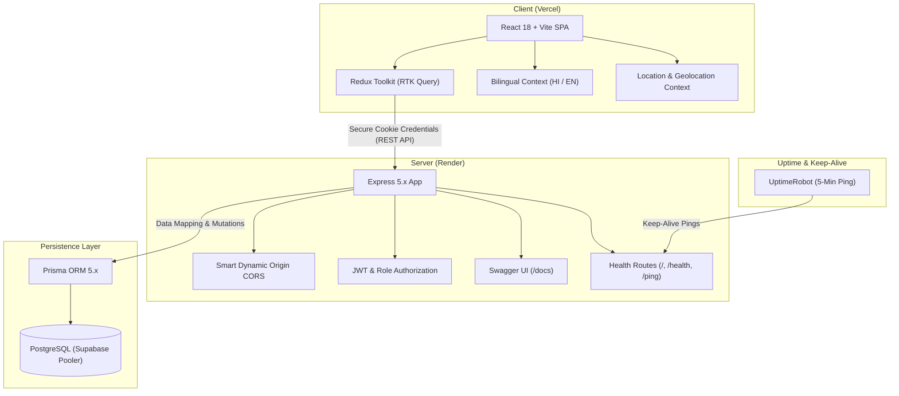

<div align="center">

# 🚗 JantaGaraj (जनता गैराज)
### *On-Demand Automotive & Home Care Marketplace Platform*

[](https://janatha-garage-o4y9.vercel.app/)
[](https://janathagarage-2puu.onrender.com/health)
[](https://janathagarage-2puu.onrender.com/docs)
[](https://opensource.org/licenses/MIT)

<p align="center">
  <b>A production-ready full-stack marketplace connecting vehicle owners and households with verified local mechanics, electricians, and technicians in real-time. Featuring doorstep arrival in under 30 minutes, transparent upfront pricing, bilingual Hindi/English localization, and complete technician lifecycle management.</b>
</p>

[Explore Live Web App](https://janatha-garage-o4y9.vercel.app/) • [Interactive API Docs](https://janathagarage-2puu.onrender.com/docs) • [API Health Status](https://janathagarage-2puu.onrender.com/health) • [Report Bug](https://github.com/Parinay-Chauhan/JanathaGarage/issues)

---

</div>

## 📌 Table of Contents

- [Overview](#-overview)
- [System Architecture](#-system-architecture)
- [Key Features](#-key-features)
- [Tech Stack](#-tech-stack)
- [Live Deployments](#-live-deployments)
- [Project Structure](#-project-structure)
- [Getting Started](#-getting-started)
  - [Prerequisites](#prerequisites)
  - [Backend Setup](#1-backend-setup)
  - [Frontend Setup](#2-frontend-setup)
- [Environment Variables](#-environment-variables)
- [API Reference](#-api-reference)
- [Uptime & Health Monitoring](#-uptime--health-monitoring)
- [Deployment Guide](#-deployment-guide)
- [Contributing](#-contributing)
- [License](#-license)

---

## 🌟 Overview

**JantaGaraj** addresses the fragmented roadside breakdown and home service market across urban and suburban India. By combining an intuitive React frontend with an Express/Prisma-powered backend and Supabase PostgreSQL, the platform bridges the gap between vehicle/home owners in urgent need of assistance and skilled, KYC-verified trade professionals.

### 💡 Core Problems Solved
- 🚫 **Unpredictable Pricing:** No hidden charges; clear upfront rate cards with verified base visiting fees.
- ⏳ **Breakdown Waiting Times:** Direct geolocation triage with a 30-minute rapid response target.
- 🛡️ **Lack of Trust & Safety:** Multi-tier technician verification (`SUBMITTED` ➔ `UNDER_REVIEW` ➔ `VERIFIED` ➔ `REJECTED`) with government ID audit trails.
- 🌐 **Language Accessibility:** Fully localized English (EN) and Hindi (हिंदी) experience across all workflows.

---

## 🏗️ System Architecture



---

## ⚡ Key Features

### 1. 🔍 Instant Service Catalog & Discovery
- High-performance, debounced catalog search across automotive repairs, AC maintenance, plumbing, electrical triage, and appliance services.
- Real-time GPS location detection with manual Indian city/pincode selector.
- Rich trade blueprints with verified starting prices and estimated completion durations.

### 2. 📋 State-Machine Driven Booking Lifecycle
Deterministic booking state engine tracking every phase of the service request:
$$\text{PENDING} \longrightarrow \text{ACCEPTED} \longrightarrow \text{EN\_ROUTE} \longrightarrow \text{ARRIVED} \longrightarrow \text{IN\_PROGRESS} \longrightarrow \text{COMPLETED}$$

### 3. 👨‍🔧 Technician Radar & KYC Verification
- Real-time technician availability toggle (`isOnline`, `isAvailable`).
- Configurable service radius in kilometers (`serviceRadiusKm`).
- Admin verification desk for reviewing Aadhaar/PAN/Driving License credentials.

### 4. 🇮🇳 Bilingual Localization
- Complete Hindi (हिंदी) and English (EN) localization powered by `LanguageContext`.
- Context-aware trade vocabulary, error messages, and customer testimonials.

### 5. 📖 Interactive Swagger API Documentation
- Live interactive Swagger documentation served directly from `/docs`.
- Try-it-out testing console for every endpoint with request schemas and status codes.

### 6. ⏱️ 24/7 Keep-Alive & Health Monitoring
- Dedicated health check endpoints (`/`, `/health`, `/ping`, `/api/v1/health`) designed for zero-downtime monitoring via UptimeRobot.
- Prevents free-tier container sleep while minimizing database connection overhead.

---

## 🛠️ Tech Stack

### Frontend
- **Framework:** [React 18](https://react.dev/) + [TypeScript](https://www.typescriptlang.org/)
- **Bundler:** [Vite 5](https://vitejs.dev/)
- **State Management:** [Redux Toolkit](https://redux-toolkit.js.org/) + RTK Query
- **Styling:** [Tailwind CSS 3](https://tailwindcss.com/)
- **Animations:** [GSAP 3](https://gsap.com/) + `@gsap/react`
- **Form Validation:** [React Hook Form](https://react-hook-form.com/) + [Zod](https://zod.dev/)
- **Icons:** [Lucide React](https://lucide.dev/)

### Backend
- **Runtime:** [Node.js](https://nodejs.org/) (ES Modules)
- **Framework:** [Express 5](https://expressjs.com/)
- **Database & ORM:** [Prisma ORM 5](https://www.prisma.io/) + [PostgreSQL](https://www.postgresql.org/) ([Supabase](https://supabase.com/))
- **Authentication:** Dual Token JWT (`accessToken`, `refreshToken`) + HTTP-Only secure cookies
- **API Documentation:** [Swagger UI Express](https://swagger.io/) + `swagger-jsdoc`
- **Security:** CORS dynamic reflection, cookie-parser, bcrypt password hashing

---

## 🚀 Live Deployments

| Service | Platform | URL |
| :--- | :--- | :--- |
| **Frontend Web App** | Vercel | [janatha-garage-o4y9.vercel.app](https://janatha-garage-o4y9.vercel.app/) |
| **Backend API Server** | Render | [janathagarage-2puu.onrender.com](https://janathagarage-2puu.onrender.com) |
| **Interactive API Docs** | Swagger | [janathagarage-2puu.onrender.com/docs](https://janathagarage-2puu.onrender.com/docs) |
| **Uptime Health Check** | Render | [janathagarage-2puu.onrender.com/health](https://janathagarage-2puu.onrender.com/health) |

---

## 📁 Project Structure

```text
JantaGaraj/
├── client/                     # Frontend Vite + React Application
│   ├── public/                 # Static assets, logos, and images
│   ├── src/
│   │   ├── api/                # Base API and Axios/Fetch configurations
│   │   ├── components/         # Reusable UI primitives, headers, modals
│   │   ├── context/            # Language (EN/HI) and Location providers
│   │   ├── features/           # Slices & RTK Query APIs (auth, bookings, services)
│   │   ├── lib/                # GSAP animation helpers and utilities
│   │   ├── locales/            # Translation dictionary (English / Hindi)
│   │   ├── pages/              # LandingPage, ServicesPage, TechniciansPage
│   │   └── types/              # TypeScript interfaces and API response contracts
│   ├── package.json
│   ├── vercel.json             # Vercel SPA routing rules & proxy config
│   └── vite.config.ts
│
├── server/                     # Backend Express.js Server
│   ├── prisma/
│   │   └── schema.prisma       # PostgreSQL models (Users, Bookings, Technicians)
│   ├── src/
│   │   ├── controllers/        # Business logic controllers
│   │   ├── db/                 # Prisma client instance & DB connectors
│   │   ├── middleware/         # Auth, Error Handling, and Role guards
│   │   ├── routes/             # Express API routes
│   │   │   ├── healthcheck.routes.js # UptimeRobot & health endpoints
│   │   │   └── ...
│   │   ├── utils/              # ApiResponse, ApiError, AsyncHandler, Swagger
│   │   ├── app.js              # Express app initialization, CORS, middlewares
│   │   └── index.js            # Server entrypoint and port listener
│   └── package.json
│
├── LICENSE                     # MIT License
└── README.md                   # Project documentation
```

---

## 💻 Getting Started

### Prerequisites
- **Node.js** >= `v18.x`
- **npm** >= `v9.x`
- **PostgreSQL Database** (e.g. [Supabase](https://supabase.com/), Neon, or local PostgreSQL instance)

---

### 1. Backend Setup

```bash
# Navigate to server directory
cd server

# Install dependencies
npm install

# Configure environment variables
cp .env.example .env
# Fill in your POSTGRES_URI, DIRECT_URL, and JWT secrets in .env

# Generate Prisma Client & Sync Database
npx prisma generate
npx prisma db push

# Start development server
npm run dev
```

The server will run on `http://localhost:8000` with Swagger Docs at `http://localhost:8000/docs`.

---

### 2. Frontend Setup

```bash
# Navigate to client directory
cd ../client

# Install dependencies
npm install

# Configure environment variables
cp .env.example .env
# Set VITE_API_URL=http://localhost:8000/api/v1 (or your production Render URL)

# Start Vite development server
npm run dev
```

Open `http://localhost:5173` in your browser.

---

## 🔐 Environment Variables

### Backend (`server/.env`)

```ini
PORT=8000
NODE_ENV=development

# Database URIs (Supabase PostgreSQL)
POSTGRES_URI="postgresql://postgres:[PASSWORD]@[HOST]:6543/postgres?pgbouncer=true"
DIRECT_URL="postgresql://postgres:[PASSWORD]@[HOST]:5432/postgres"

# Authentication Secrets
ACCESS_TOKEN_SECRET="your_access_token_secret_min_32_chars"
ACCESS_TOKEN_EXPIRY="1d"
REFRESH_TOKEN_SECRET="your_refresh_token_secret_min_32_chars"
REFRESH_TOKEN_EXPIRY="10d"

# CORS Configuration
CORS_ORIGIN="http://localhost:5173"
```

### Frontend (`client/.env`)

```ini
# Production Render backend or local server
VITE_API_URL="https://janathagarage-2puu.onrender.com/api/v1"

# Firebase Client Configuration (Optional)
VITE_FIREBASE_API_KEY="your_firebase_api_key"
VITE_FIREBASE_AUTH_DOMAIN="your_project.firebaseapp.com"
VITE_FIREBASE_PROJECT_ID="your_project_id"
```

---

## 📡 API Reference

A brief summary of primary API routes. For complete request/response schemas, visit the live [Swagger UI Documentation](https://janathagarage-2puu.onrender.com/docs).

| Method | Endpoint | Description | Auth Required |
| :--- | :--- | :--- | :--- |
| `GET` | `/` | Root keep-alive ping | ❌ None |
| `GET` | `/health` | System health, uptime & status | ❌ None |
| `GET` | `/docs` | Interactive Swagger API Docs | ❌ None |
| `POST` | `/api/v1/users/register` | Register new customer or technician | ❌ None |
| `POST` | `/api/v1/users/login` | Login and issue HTTP-only cookies | ❌ None |
| `POST` | `/api/v1/users/logout` | Clear auth cookies | ✅ Yes |
| `GET` | `/api/v1/services` | Retrieve all active services | ❌ None |
| `GET` | `/api/v1/categories` | List service trade categories | ❌ None |
| `GET` | `/api/v1/technicians` | Search & filter verified technicians | ❌ None |
| `POST` | `/api/v1/bookings` | Create new doorstep service booking | ✅ Customer |
| `PATCH` | `/api/v1/bookings/:id/status`| Transition booking state | ✅ Technician / Admin |
| `GET` | `/api/v1/admin/kyc-pending` | Review pending technician KYC requests | 🛡️ Admin |

---

## 🤖 Uptime & Health Monitoring

To ensure the backend server hosted on Render's free tier remains permanently warm and avoids cold starts:

1. Create a monitor on [UptimeRobot](https://uptimerobot.com/).
2. Select **Monitor Type**: `HTTP(s)`.
3. Set **URL**: `https://janathagarage-2puu.onrender.com/health`.
4. Set **Interval**: `5 minutes`.

This sends periodic lightweight pings returning `200 OK`, maintaining container responsiveness without consuming database connection pooling limits.

---

## 🚢 Deployment Guide

### Vercel (Frontend)
1. Link your GitHub repository in the Vercel dashboard.
2. Set **Root Directory**: `client`.
3. Build Command: `vite build` (or `npm run build`).
4. Output Directory: `dist`.
5. Add Environment Variable:
   - `VITE_API_URL` = `https://janathagarage-2puu.onrender.com/api/v1`

### Render (Backend)
1. Create a **Web Service** linked to the GitHub repo.
2. Set **Root Directory**: `server`.
3. Build Command: `npm install && npx prisma generate`.
4. Start Command: `npm start`.
5. Add Environment Variables:
   - `NODE_ENV` = `production`
   - `POSTGRES_URI` = `[Your Supabase Transaction Pooler URI]`
   - `DIRECT_URL` = `[Your Supabase Direct Session URI]`
   - `ACCESS_TOKEN_SECRET` = `[Secret]`
   - `REFRESH_TOKEN_SECRET` = `[Secret]`
   - `CORS_ORIGIN` = `https://janatha-garage-o4y9.vercel.app`

---

## 🤝 Contributing

Contributions, issues, and feature requests are welcome!

1. Fork the Project.
2. Create your Feature Branch (`git checkout -b feature/AmazingFeature`).
3. Commit your Changes (`git commit -m 'feat: Add some AmazingFeature'`).
4. Push to the Branch (`git push origin feature/AmazingFeature`).
5. Open a Pull Request.

---

## 📄 License

Distributed under the **MIT License**. See [`LICENSE`](./LICENSE) for more information.

---

<div align="center">
  <b>Developed with ❤️ by <a href="https://github.com/Parinay-Chauhan">Parinay Chauhan</a></b>
</div>
